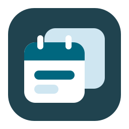
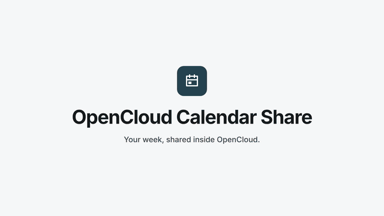

<p align="center"></p>

# opencloud-calendar-share

Calendars for [OpenCloud](https://opencloud.eu), on top of [Radicale](https://radicale.org) (CalDAV/CardDAV):

- **Calendar sharing** between users (read or write), visible in every CalDAV client
- **Event invitations**: guests get the event in their own calendar and answer it (web app, links in the
  event, or their CalDAV client); invitations created in Thunderbird / DAVx⁵ work too
- **Calendar app for OpenCloud Web**: month / week / day / list views, drag & drop, colors, search,
  auto-refresh, invitations bell in OpenCloud's top bar, calendar creation, sharing management

<p align="center">
  
</p>

<p align="center">▶ <a href="docs/assets/demo.mp4">Download the video (MP4, 1080p, 46 s, no sound)</a></p>

## Architecture


| Component | Source | Published as |
|---|---|---|
| calshare sidecar (sharing API, invitations agent) | `sidecar/` | `ghcr.io/paulmascarilla/opencloud-calendar-share/calshare` |
| OpenCloud Web extension "calendar" | `web-extension/` | `ghcr.io/paulmascarilla/opencloud-calendar-share/web`, zip in each release |
| Helm chart | `charts/opencloud-calendar-share/` | `oci://ghcr.io/paulmascarilla/charts/opencloud-calendar-share` |
| Docker Compose overlay | `deploy/compose/calendar.yml` | `calendar.yml` in each release |

## Quick start

```sh
helm install calendar oci://ghcr.io/paulmascarilla/charts/opencloud-calendar-share --version <x.y.z> \
  -n opencloud --set fullnameOverride=calendar \
  --set calshare.publicUrl=https://cloud.example.com \
  --set opencloud.patch.enabled=true
```

Then open **Calendar** in OpenCloud's app menu. Users connect CalDAV clients to `https://cloud.example.com/caldav/`.

With [opencloud-compose](https://github.com/opencloud-eu/opencloud-compose), use the Compose overlay instead
(`calendar.yml` in each release, in place of `radicale/radicale.yml`):

```sh
mkdir -p calendar && curl -fsSL -o calendar/calendar.yml \
  https://github.com/paulmascarilla/opencloud-calendar-share/releases/latest/download/calendar.yml
echo "CALENDAR_PROXY_SECRET=$(openssl rand -hex 32)" >> .env   # and add calendar/calendar.yml to COMPOSE_FILE
docker compose up -d
```

## Documentation

| | |
|---|---|
| [Installation](docs/installation.md) | Docker Compose, Helm values, wiring OpenCloud, service account, private packages, security, upgrade / uninstall |
| [Calendar sharing](docs/calendar-sharing.md) | how sharing works, REST API |
| [Event invitations](docs/invitations.md) | guests, answers, CalDAV clients, REST API, internals |
| [Calendar app](docs/web-app.md) | the OpenCloud Web extension: views, invitations bell, auto-refresh |
| [Development](docs/development.md) | local builds, kind, tests, release process |

## License

[AGPL-3.0](LICENSE). In short: you may use, modify and sell services built on it. Users who interact with a
modified version over the network must be able to get its source. The calendar app links to this repository
("Source code · AGPL-3.0" in the sidebar and on the invitation page). If you run a modified version, point
`SOURCE_URL` in `web-extension/src/about.ts` to your own source.

Third-party components: Radicale (GPL-3.0, separate program), OpenCloud Web packages (AGPL-3.0),
FullCalendar (MIT), ical.js (MPL-2.0). The sidecar is written in Go with the standard library only.
